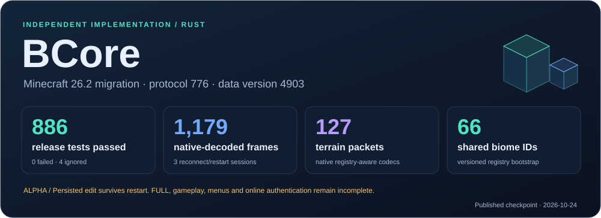
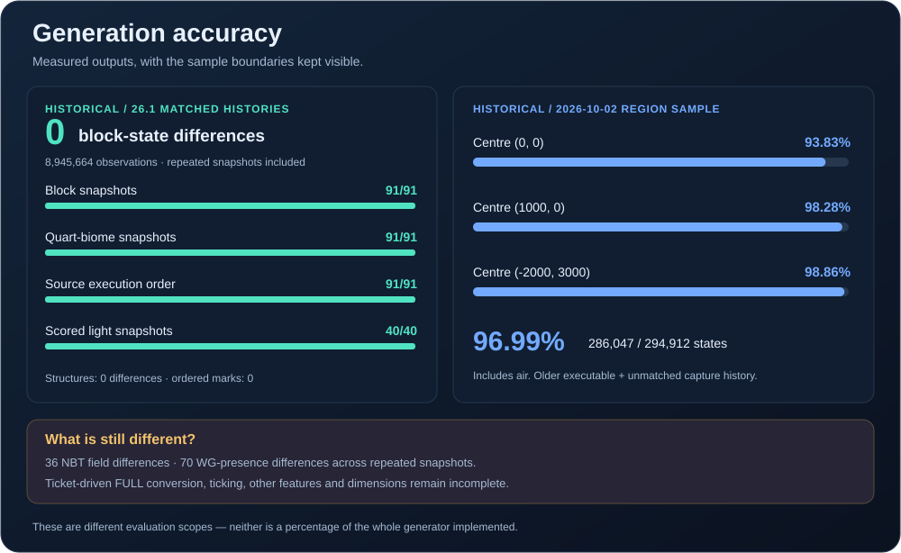
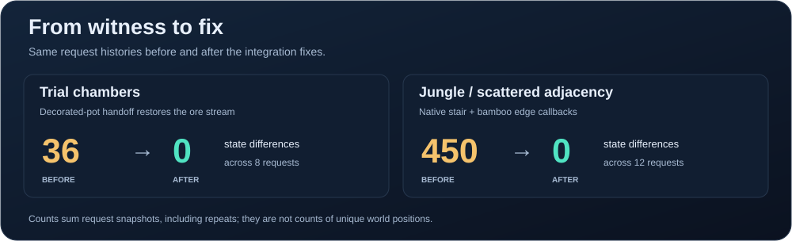
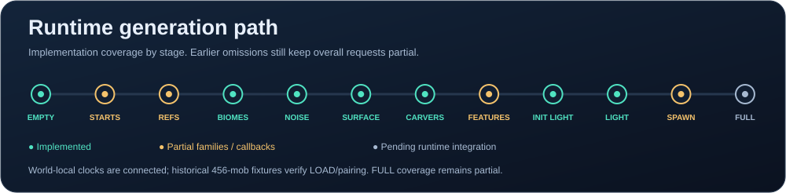

# BCore

<p align="center">
  
</p>

<p align="center">
  <a href="https://github.com/HVHBIGNAME/BCore/actions/workflows/ci.yml"></a>
  <a href="https://HVHBIGNAME.github.io/BCore/"></a>
  <a href="docs/migration-26.2.md"></a>
  <a href="LICENSE"></a>
</p>

A native [Minecraft: Java Edition](https://www.minecraft.net) server written in Rust, targeting **26.2 / protocol 776 / data version 4903**. [SteelMC](https://github.com/Steel-Foundation/SteelMC) is the primary implementation reference.

BCore is an **independent implementation** (not a fork) aiming for vanilla parity while making better use of modern multi-core hardware — plus a native plugin system and a Bukkit/Spigot/Paper plugin bridge.

> **Status: alpha, vanilla parity incomplete.** Offline login, chunk streaming, chat, commands and persistence are implemented. Current work targets generation parity and responsive gameplay. See the [implementation tracker](https://HVHBIGNAME.github.io/BCore/) and [measured parity report](docs/parity-report.md).

The [26.2 migration checkpoint](docs/migration-26.2.md) includes **886 passing
workspace release tests**, native decoding of **1,179 BCore frames / 127 terrain
packets**, reconnect/process-session checks and a saved-block edit observed after
restart. Shared registries and BCC v6 bind numeric IDs to the authenticated target.

[Authoritative creative block gameplay](docs/creative-block-gameplay-2026-10-25.md)
adds tick-owned full-cube break/place, hotbar selection, viewer updates and dirty
save/restart checks: **921 passing workspace tests**, **6 actual TCP scenarios**,
**25 native codec cases**. Full physics, menus and survival remain in development.

[Axis-only creative gameplay](docs/creative-pillar-gameplay-2026-10-26.md) extends
that slice with **56 pillar items / 168 states**, selected X/Y/Z placement and
instant creative break. **336 repeat-matching native placement/codec cases** and
**43 focused tests**, including three new TCP scenarios, verify current viewers,
negative/chunk-border coordinates, canonical reads, dirty saving and restart.
That workspace checkpoint is **927 passed / 0 failed / 4 ignored**, 72 suites.

[Runtime responsiveness](docs/runtime-latency-2026-10-27.md) adds nonblocking action
ingestion, revisioned asynchronous saving, partial-frame recovery and client-paced
chunk delivery. The latest checkpoint is **939 passed / 0 failed / 4 ignored**.
The 32-break TCP regression improves from **1881 to 244 ms median**; repeated
production probes report **20 TPS** during generation, including **488 actual
place/break actions** with saved readback. The report retains latency tails,
delivery-rate tradeoffs and the exact before/after BCore workload.

[Development status, cleanup and open requirements — updated 2026-10-27](docs/development-status-2026-10-24.md).

<p align="center">
  <a href="#generation-accuracy">Accuracy</a> ·
  <a href="#performance-comparison">Performance</a> ·
  <a href="#current-work">Progress</a> ·
  <a href="#building">Run BCore</a> ·
  <a href="docs/metrics/README.md">Measurement data</a>
</p>

## Generation accuracy



**Historical 26.1 retained implementation:** [791 passing workspace release tests](docs/metrics/noise-final-validation-2026-10-21.json),
zero failures, and four fresh schema-3 histories with **27/27 requested** and
**52/54 watch** scored matches. The four known LIGHT/SPAWN status fields remain
different; implementation coverage stays Partial.

**Earlier broader corpus:** 91 requests across 15 matching native execution histories,
with **0 block-state, biome, source-order or scored-light differences**. That is
8,945,664 block-state observations, including air and repeated snapshots.
The [2026-10-10 evidence](docs/metrics/checkpoint-2026-10-10.json) adds the
three-request desert-well witness on the same published executable. It retains
the October 8 **665 passing workspace tests** on unchanged Rust sources; this is
an expanded replay checkpoint, not a newly run full test suite.

The older three-region comparison remains **286,047 / 294,912 states (96.99%)**,
768/768 terrain heights and 4,608/4,608 biome cells. It uses an older executable
and a different capture history. **Neither result means 100% worldgen completion.**
The remaining **36 NBT field differences** and **70 WG-heightmap presence differences**
are tracked with FULL conversion and other omissions in the
[detailed report](docs/parity-report.md).

### Concrete fixes



- **Trial chambers:** native decorated-pot NBT handoff now lets the neighbouring
  andesite stream finish. All nine before/after dependency chunks and RNG
  continuation witnesses match the native capture.
- **Jungle adjacency:** 10,212 native stair updates and 9,360 bamboo updates verify
  live neighbour reads, shape changes and scheduled-tick order.
- **Fossils and desert pyramids:** three parallel repair tracks reproduced missing
  terrain and deferred-NBT behavior. Fossils remove **269 + 103** differing block
  observations; desert pyramids remove **7,627**. The integrated histories match
  their native templates, shared RNG, geometry, chest flags and archaeology.
  [Implementation and native evidence](docs/generation-milestone-2026-10-07.md).
- **Desert wells:** the published main executable also matches the three-request
  seed-42 witness, including the adjacent chunk, repeated request and archaeology
  block-entity data.

## Performance comparison

The [runtime before/after report](docs/runtime-latency-2026-10-27.md) measures
generation-time correction p95 **1718/1781 → 141/187 ms** against the previous BCore
build. Median correction latency rose **93 → 125 ms**, and client-paced delivery
sent fewer chunks. These runtime results are separate from the Java kernel
comparison below; whole-server Java superiority remains an open goal.


This chart compares the **terrain material-fill kernel** in BCore and the authenticated
Vanilla 26.2 JAR on the same machine, seed, eight chunks and worker budgets.
It includes aquifers, noise ore veins, fluid postprocessing requests and both
worldgen heightmaps; it excludes server startup, later generation stages,
storage, packets and gameplay. It is **not a full-server TPS ranking**.
Bars show medians; whiskers show variation between fresh processes.

The 26.2 baseline measures **47.79 / 83.98 / 156.81 chunks/s for BCore** and
**49.77 / 74.03 / 215.35 for Vanilla** at 1/2/4 workers. BCore is faster at two
workers in this run; Java is faster at one and four. All **18 process records**
match blocks, ordered marks and both WG maps, with **180 warmup and 180 measured
batches** retained. The host is unisolated; this is a baseline, not a cross-version
optimization gain.

[26.2 timings and frozen-input provenance](docs/metrics/noise-fill-wg-v2-baseline-26_2-2026-10-24.json) ·
[Hardware, controls and reproduction commands](docs/performance.md)

The [fresh CPU profile](docs/performance-profile-26.2-2026-10-24.md) collected
**4,002 leaf samples** with matching kernel outputs. It identifies interpolation
and noise/density evaluation as current optimization targets; sampled diagnostic
timings are excluded from these throughput numbers.

The [October 26 cache experiments](docs/performance-experiments-26.2-2026-10-26.md)
retain **126 matching process records** and two alternating frozen confirmations
per candidate. Both lookup/storage variants were rejected after mixed or
regressing results; production source bytes were restored. The Java performance
goal remains open.

### Historical 26.1 optimization series

The separate [October 21 run](docs/metrics/noise-fill-wg-v2-final-2026-10-21.json)
measures **39.60 / 71.13 / 140.00 chunks/s for BCore** and **44.16 / 88.43 / 198.41
for Vanilla 26.1**. These historical measurements retain their original target.

Selective density outlining, chunk-owned indexed interpolation and borrowed-point
evaluation produced a directly measured **2.02–2.45× gain** against the October 18
checkpoint in two alternating frozen comparisons. All 18 individual pairs
improved, with matching block/effect/WG-map fingerprints. The
[complete series](docs/metrics/noise-fill-wg-v2-series-2026-10-21.json) preserves
every process's warmup and measured durations, including rejected experiments.
Historical gains from different sessions are not multiplied into this result.

[Exact timings, optimization series, hardware and reproduction commands](docs/performance.md) ·
[Final measurements and hashes](docs/metrics/noise-fill-wg-v2-final-2026-10-21.json)

The later cell-miss, constant-operand and Perlin-rounding prototypes were
**rejected and restored** after mixed or regressing comparisons. Their
[experiment report](docs/performance-experiments-2026-10-21.md) records the checks
and timings; they contribute no production speedup.

## Current work



| Delivered | Current focus | Following work |
|---|---|---|
| Shared cross-chunk generation; native light storage and updates | Ticket-driven FULL conversion, remaining terrain families and broader seed samples | Worldgen-heightmap retirement, saved-holder hydration, Nether/End |
| Fossils; villages, ancient cities, trail/trial jigsaws; treasure, huts, jungle, desert pyramids and **desert wells** | Preserve real native behavior across combined request histories | Remaining structure families, persistent generation graph |
| Shared 26.2 registries; BCC v6 admission; world-local clocks; native-decoded reconnect/restart; matched 26.2 NOISE baseline and fresh CPU profile | FULL boundaries and source-owned runtime effects | Isolated interpolation/noise optimization with exact-output and paired-run gates |
| Tick-owned creative stateless and axis-only full-cube gameplay; client-paced streaming; revisioned async dirty saves; viewer/restart tests | Remaining stateful blocks, neighbour callbacks and player/inventory boundaries | Physics, survival, menus and persisted playerdata |

Project updates and evidence are published together in the
[tracker](https://HVHBIGNAME.github.io/BCore/), [parity report](docs/parity-report.md)
and [roadmap](docs/roadmap.md).

## Highlights

- Native Rust, multi-crate workspace (bounded contexts).
- Protocol 776: strict handshake admission, status, offline login, configuration and play.
- Native plugin system: trait-based `Plugin`, thread-safe `PluginManager`, events, dynamic `.dll`/`.so` loading.
- Data-driven seed-based Overworld generation with bundled assets and offline vanilla-reference tests. Trees, caves, ores and structures are not yet block-for-block compatible.
- Shared, status-aware generation across chunk requests, with explicit source coverage and persisted generated block-entity data, ticks and postprocessing marks.
- JVM virtualization bridge for Bukkit/Spigot/Paper plugins (ADR-0001) — loads an original `.jar` and invokes `onEnable`.

## Crates

| Crate | Purpose |
|---|---|
| `bcore` | Server binary |
| `bcore-core` | Shared types, version constants, protocol primitives |
| `bcore-protocol` | Protocol 776: login/play, commands, streaming and versioned persistence |
| `bcore-plugin` | Native plugin API and manager |
| `bcore-plugin-java` | JVM bridge for legacy Java plugins |
| `bcore-worldgen` | Deterministic seed-based generation |
| `bcore-registry` | Authenticated shared block/state/item/entity/attribute identities |

## Building

```bash
cargo build --workspace --release --locked -j 1
cargo test --workspace --release --locked --no-fail-fast -j 1 -- --test-threads=2
```

Run the server:

```bash
cargo run -p bcore --release --locked -- --world world-26.2 --seed 846692123413862008 --host 127.0.0.1 --port 25565
```

Use a **Java 26.2** client and connect to **127.0.0.1:25565**. The server uses offline
login. The default fresh world is `world-26.2`; `--world` and `--seed` select an
explicit world identity. Operators and bans are stored inside that world root.

BCC v6 checks the seed, data/protocol version and registry fingerprint before
loading. Older or foreign saves require a separate compatible build; this migration
does not convert them. The worldgen data ships inside the executable.
`BCORE_DATAPACK` optionally selects an external extracted datapack for development.
See [validation scope and frozen-executable instructions](docs/migration-26.2.md).

### Generate with explicit coverage

The worldgen API retains neighbouring work across requests and reports missing
stages alongside the generated chunk:

```rust
use bcore_core::ChunkPos;
use bcore_worldgen::{generation::ChunkStatus, GenerationWorld};

let world = GenerationWorld::new(846692123413862008);
let result = world.generate_to_status(ChunkPos::new(14, 8), ChunkStatus::Light)?;

println!("Block states: {}", result.chunk.states().len());
println!("Complete native coverage: {}", result.coverage.is_complete());
for missing in &result.coverage.missing_stages {
    println!("{}: {}", missing.status, missing.reason);
}
```

Charts are committed SVGs generated from versioned evidence. To check them:

```bash
python scripts/render_readme.py --check
```

## Documentation

- [Implementation tracker](https://HVHBIGNAME.github.io/BCore/)
- [Latest completed tasks and open requirements](docs/development-status-2026-10-24.md)
- [Measured parity report](docs/parity-report.md)
- [26.2 migration, protocol validation and fresh-world instructions](docs/migration-26.2.md)
- [Performance comparison and methodology](docs/performance.md)
- [Published measurement data](docs/metrics/README.md)
- [Worldgen parity plan](docs/worldgen-parity-plan.md)
- [Native feature scheduling](docs/feature-scheduling.md)
- [Generated tree effects, persistence and tick preparation](docs/tree-effects.md)
- [Architecture](docs/architecture.md)
- [Reference projects](docs/references.md)
- [Paper/Purpur patch strategy](docs/paper-purpur-patches.md)
- [ADR-0001: plugin translation strategy](docs/adr/0001-plugin-translation-strategy.md)

## License

MIT — see [LICENSE](LICENSE).
