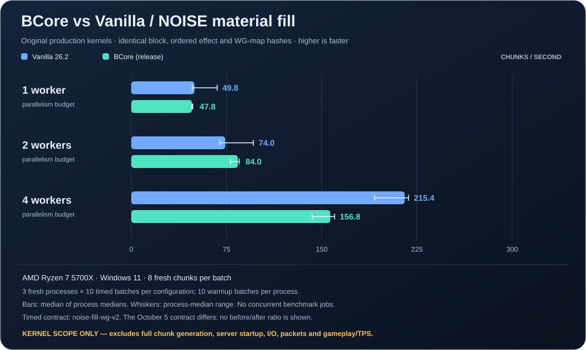
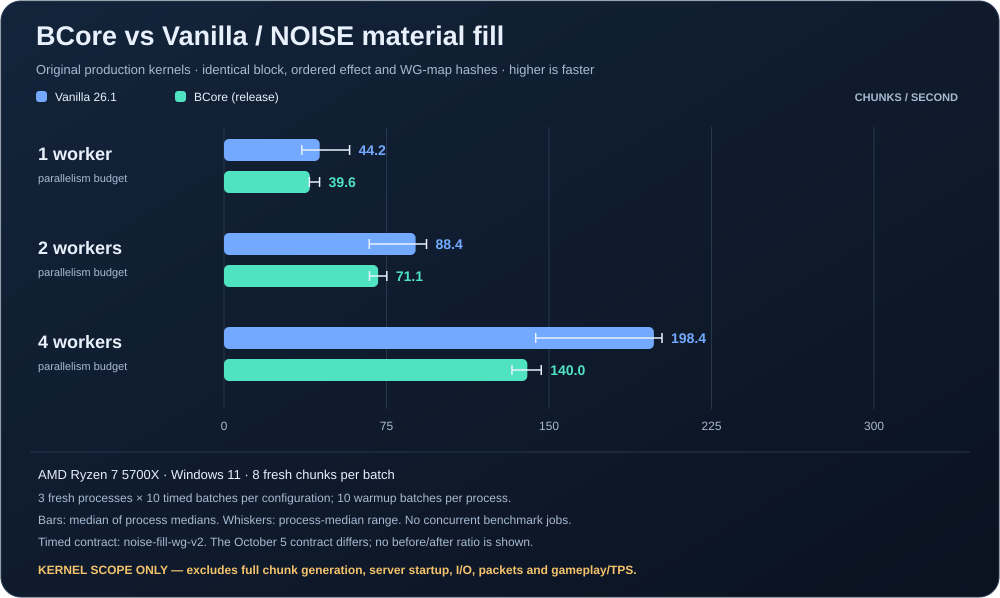

# BCore / Vanilla performance measurements

The Java comparisons measure **NOISE terrain material filling**. The runtime and
creative-flight checkpoints measure BCore before/after under production generation,
movement and creative actions. In the kernel comparisons, both implementations
produce the same complete block-state arrays, ordered per-section fluid
postprocessing marks **and both worldgen heightmaps** for every measured and
warmup batch.

## Creative-flight chunk delivery — 2026-10-27

The [flight report](creative-flight-2026-10-27.md) verifies refreshable per-view
demand, ready-chunk selection and motion-directed admission. **945 workspace tests
passed** with 0 failures and 4 ignored; 396 worldgen/registry files retain baseline
bytes. The route moves at 21.78 blocks/s with two Rayon workers and default release.

- Three fresh-flight minimum margins: **0/8/8 → 72/72/80 blocks**; medians
  **16/24/24 → 88/88/88**, including alternating frozen confirmations.
- Eight accepted fresh/saved/turn/long sessions: **2522 samples**, zero missing-current
  chunks, all nearest 3×3 chunks delivered at every sample. The **60-second** route
  keeps a minimum **80-block** sampled forward margin; all new reporting windows show 20 TPS.
- Two comparisons of common initially saved columns: **2277 payload pairs / 0 differences**.
  A separate **490-action / 170-chunk** edit session verifies ordered updates and final saved AIR.
- Queue-only demand refresh was insufficient: 22/280 missing-current fresh samples.
  Motion priority is part of the selected solution. Ping p95 increases slightly;
  the complete baseline and candidate distributions are retained.

Lead is sampled along the movement ray every 8 blocks, capped at 136. Full-view
readiness, GUI smoothness and matched Java flight remain unmeasured. A separate
10,065-leaf-sample CPU diagnostic is excluded from the default-release comparisons.
[Coverage, identities and all runs](metrics/creative-flight-validation-2026-10-27.json).

## Runtime responsiveness — 2026-10-27

The [source-bound runtime report](runtime-latency-2026-10-27.md) fixes tick/generation
lock contention, blocking action ingestion, per-edit light amplification and
synchronous dirty writes. **939 workspace tests passed** with 0 failures; 12 new
regressions cover ordering, framing, flow credit, busy generation and durability.

- 32-break TCP regression: median **1881.04 → 243.79 ms**, three test processes per
  revision; saved readback and all viewer updates match.
- Two alternating frozen production comparisons: correction p95 **1718/1781 →
  141/187 ms**, with **20 TPS** throughout the new reporting windows.
- Sustained production edits: 488 actual mutations while 171 chunks arrive; median
  ack 124.31 ms, p95 187.50 ms, max 614.18 ms; all updates ordered and final AIR saved.
- 245 + 238 paired terrain payloads match exactly. Median correction latency rose
  **93 → 125 ms**, while client-paced streaming delivered 245/238 chunks versus 320/318.

These observations compare BCore revisions on an unisolated host. They establish
lower tail latency in the declared workloads; whole-server Java superiority and
GUI rendering performance still require their own matched measurements.
[Raw identities, process summaries and limitations](metrics/runtime-latency-validation-2026-10-27.json).



## Current target — 26.2 / protocol 776

The baseline was captured on October 23 UTC and published on October 24. It runs
the authenticated **26.2 / 776 / data version 4903** JAR with all **39 libraries**;
the native runtime reports that identity and its actual worker pool. BCore is built
from a frozen **489-input** source archive. All **18 fresh process records** and
their **180 warmup / 180 measured batches** match the kernel fingerprints.

| Worker budget | Vanilla 26.2 batch | BCore release batch | Vanilla chunks/s | BCore chunks/s |
|---|---:|---:|---:|---:|
| 1 | 160.73 ms | 167.39 ms | 49.77 | 47.79 |
| 2 | 108.06 ms | 95.26 ms | 74.03 | 83.98 |
| 4 | 37.15 ms | 51.02 ms | 215.35 | 156.81 |

BCore is faster at two workers in this run; Java is faster at one and four.
Bars use the median of three process medians; whiskers show their full range.
Native process medians range **118.30–166.45 ms** at one worker and
**83.20–114.68 ms** at two. Fixed warmup counts and all durations are retained;
steady-state convergence and the cause of this variation are not established.
The host is unisolated. These are baseline observations, not an optimization gain
against historical 26.1 or complete-server throughput.

Raw results SHA-256:
`445993fa5be405614d139122672459bb9dccf1cbf7c7e6d3ac3f17e25f66816c`.
Frozen source archive SHA-256:
`c41879e3ecfa5d2c05c13d563b446596641e3d40568a55d2c4a5c83f894013ea`.
Native logs retain the bundled JOML 1.10.8 warning about
`sun.misc.Unsafe::objectFieldOffset`; the authenticated library is unchanged.

[26.2 samples, fingerprints and provenance](metrics/noise-fill-wg-v2-baseline-26_2-2026-10-24.json) ·
[Migration and protocol validation](migration-26.2.md)

A [fresh owned-child CPU profile](performance-profile-26.2-2026-10-24.md) collected
**4,002 leaf samples** on the same final-release source snapshot, with matching
kernel fingerprints. Interpolation, Perlin noise and density evaluation lead the
resolved sample counts. The diagnostic build and sampled durations are separate
from this throughput baseline; attribution limitations and sampler failures are
preserved in the profile report.

### First-axis delta candidate — 2026-10-25

The localized eight-f64 base/delta candidate passed 10 bit/order and 9 native
numeric/ore/RNG tests, with identical outputs across **72 fresh processes**.
Two alternating frozen confirmations measured **1.0123× / 1.0133×** at one worker,
**1.0372× / 1.0139×** at two, and **0.9990× / 0.9929×** at four. It was **rejected**
and the original source bytes restored. The complete-server/Java goal remains open.
[Measurements and limitations](performance-experiments-26.2-2026-10-25.md) ·
[Versioned evidence](metrics/noise-axis-delta-rejected-26_2-2026-10-25.json).

### Seeded-cache candidates — 2026-10-26

An isolated hit-return lookup and a compact name-index/dense-resource cache each
passed **21 bit/order/native tests**. Across **126 matching processes**, two
alternating confirmations per candidate found no repeated all-budget gain:
hit-return regressed at four workers (**0.953915× / 0.987303×**); dense index had
mixed one/two-worker results despite small four-worker gains. Both prototypes
were rejected; all **510 baseline source inputs** were restored byte-exactly.

[Complete measurements and controls](performance-experiments-26.2-2026-10-26.md) ·
[126 process medians, frozen identities and restoration proofs](metrics/noise-cache-experiments-26_2-2026-10-26.json).

## Historical 26.1 results — 2026-10-21, contract `noise-fill-wg-v2`



The historical chart uses the final retained October 21 implementation. Selective density
outlining, chunk-owned indexed interpolation and borrowed-point evaluation passed
their checks. Subsequent cell-miss, constant-operand and Perlin-rounding variants
were removed after negative or mixed frozen-binary measurements.

Eight fresh chunks per batch; three independent processes per configuration,
each with ten warmup and ten measured batches. Bars show the median of process
medians; whiskers retain their range.

| Worker budget | Vanilla 26.1 batch | BCore release batch | Vanilla chunks/s | BCore chunks/s |
|---|---:|---:|---:|---:|
| 1 | 181.16 ms | 202.02 ms | 44.16 | 39.60 |
| 2 | 90.46 ms | 112.46 ms | 88.43 | 71.13 |
| 4 | 40.32 ms | 57.14 ms | 198.41 | 140.00 |

Java remains **1.12× / 1.24× / 1.42× faster** in this final bounded run.
Exceeding Java across all worker budgets has not been established.

Two additional **direct frozen comparisons** against the October 18 chest
checkpoint measured the cumulative retained changes in the same sessions:

| Worker budget | Gain, run 1 | Gain, run 2 |
|---|---:|---:|
| 1 | 2.075546× | 2.027788× |
| 2 | 2.453408× | 2.249699× |
| 4 | 2.138244× | 2.017397× |

All 18 individual pairs improved and all 54 full/cumulative process records
matched blocks, ordered marks and both WG maps. This is a directly measured
**2.02–2.45× BCore-relative gain**, rather than a product of historical stage ratios.

The same 419-input implementation passed a fresh **791-test workspace release
checkpoint**, format/build/diagnostics checks and server `--help`. Four new
schema-3 histories retain **27/27 requested** and **52/54 watch** scored matches
with the same four LIGHT/SPAWN status differences and Partial coverage.

[Final timings and provenance](metrics/noise-fill-wg-v2-final-2026-10-21.json) ·
[All experiments and cumulative comparisons](metrics/noise-fill-wg-v2-series-2026-10-21.json) ·
[Workspace/replay evidence](metrics/noise-final-validation-2026-10-21.json) ·
[Implementation and rejected candidates](performance-experiments-2026-10-21.md)

## Historical results — 2026-10-08, contract `noise-fill-wg-v2`

Eight fresh chunks per batch; median of three independent process medians. Each
process runs ten warmup batches and ten timed batches. Higher throughput is better.

| Worker budget | Vanilla 26.1 batch | BCore release batch | Vanilla chunks/s | BCore chunks/s |
|---|---:|---:|---:|---:|
| 1 | 120.91 ms | 660.20 ms | 66.16 | 12.12 |
| 2 | 104.93 ms | 493.39 ms | 76.24 | 16.21 |
| 4 | 39.45 ms | 181.25 ms | 202.77 | 44.14 |

**BCore was slower in this historical bounded workload**, with a measured gap of
about **4.6×–5.5×**. Its one-to-four-worker throughput rose about
**3.64×**; Vanilla's rises about **3.07×**. These are
local observations on an unisolated machine, not a server TPS ranking.

### What the optimization series changed

Three exact-behavior passes were measured under this identical contract, each
verified against the same output fingerprints (all blocks, ordered marks and both
WG maps):

| Pass | Change | BCore chunks/s, 1 / 2 / 4 workers |
|---|---|---:|
| Baseline `3eb15d3` | — | 2.04 / 3.24 / 4.31 |
| 1 | Aquifer centers keyed instead of linearly scanned, quart-quantized preliminary surface heights memoized (measured 140.9× redundancy), one aquifer/material context per Rayon job | 4.04 / 6.39 / 8.35 |
| 2 | Fast deterministic hasher for internal lookup tables whose keys are exact bits, and seeded normal-noise lookups by borrowed name (two `String` allocations per sample removed) | 11.30 / 12.60 / 15.50 |
| 3 | Material/density cache lifetime moved to the whole chunk, matching native's one `NoiseChunk`/aquifer per chunk; nested column parallelism removed because callers already parallelize across chunks | 12.12 / 16.21 / 44.14 |

Cumulative gain at four workers is **10.24×** over the first baseline of this
contract (**4.3096 → 44.1368 chunks/s**). The repeated baseline measured
**4.9705 chunks/s**, giving **8.88×** against that repeat. The
[compact series](metrics/noise-fill-wg-v2-series-2026-10-08.json) preserves both
baselines and all three passes, with per-process medians and raw-result hashes.
Profiling that motivated the passes measured, per 24 chunks: 601,890 preliminary
surface evaluations over only 1,424 distinct coordinates, ~13.9M `FindTopSurface`
steps beneath them, and Rayon-dependent cache fragmentation (48 jobs at one worker
versus 385 at four, with 2D-cache misses rising 4.7×).

### Honest caveats

- Across these runs on the same machine, one-worker Java run summaries ranged
  **26.3–66.2 chunks/s**.
  BCore's one-worker baseline summaries were **2.04 and 2.06 chunks/s**, but its
  four-worker baselines varied by about **15%**. Both engines remain subject to
  machine noise; the series preserves process-level variation rather than a
  confidence interval or an isolated causal estimate. JIT/GC or scheduling may
  contribute, but this series did not profile the cause of the variation.
- The timed contract is new. It includes Rust's normal post-NOISE WG heightmap
  capture (which the earlier October 5 measurement omitted) and keeps Rust's
  surface-biome bookkeeping and native reflection/scratch work inside the timer.
  It is therefore **not** comparable with the earlier `noise-fill-kernel` series.
- Every benchmark pass matches the bounded kernel fingerprints. Separately, the
  [final 665-test checkpoint](metrics/checkpoint-2026-10-08-optimized.json)
  records 88 requests with zero differences in 8,650,752 block-state observations,
  135,168 biome-cell observations and 40 scored light snapshots. It still has
  **36 block-entity field differences and 70 WG-presence differences**; none of
  those requests has complete native coverage. This is not full parity.

[Final phase-3 samples, fingerprints and provenance](metrics/noise-fill-wg-v2-2026-10-08.json)

## Previous measurement — 2026-10-05, contract `noise-fill-kernel`

Kept unchanged and published separately; its timed boundary did not include the
WG heightmap capture.

| Worker budget | Vanilla 26.1 batch | BCore release batch | Vanilla chunks/s | BCore chunks/s |
|---|---:|---:|---:|---:|
| 1 | 162.70 ms | 3,028.97 ms | 49.17 | 2.64 |
| 2 | 93.87 ms | 2,179.34 ms | 85.23 | 3.67 |
| 4 | 47.48 ms | 1,373.06 ms | 168.49 | 5.83 |

At four workers the measured difference was about **28.9×** under that contract.
All eighteen processes and 180 batches matched in block states and ordered marks,
including warmups, and the machine was not OS-isolated.

[October 5 samples, fingerprints and provenance](metrics/noise-fill-2026-10-05.json)

## Workload and controls

| Setting | Value |
|---|---|
| CPU | AMD Ryzen 7 5700X, 8 physical cores / 16 logical processors |
| OS | Windows 11, build 26200 |
| Native engine | Authenticated Minecraft Java 26.2 / protocol 776 JAR; historical rows explicitly use 26.1 / 775 |
| Rust build | Release, `--locked`, diagnostics-enabled benchmark wrapper |
| World seed | `846692123413862008` |
| Chunks | `(0,0)`, `(1,0)`, `(0,1)`, `(1,1)`, `(-64,-32)`, `(-63,-32)`, `(62,0)`, `(-125,187)` |
| Geometry | 16 × 384 × 16 per chunk, Y=-64..319 |
| Inputs | Fresh empty chunks, original overworld noise settings, empty structure references, no blending |
| Included work | Production material fill, aquifers, noise ore veins, fluid postprocessing requests and both WG heightmaps |
| BCore parallelism | Explicit Rayon pool of 1 / 2 / 4 workers; independent chunks submitted as a batch |
| Vanilla parallelism | `max.bg.threads=N`, `ActiveProcessorCount=N+1`; original async `fillFromNoise` tasks, verified as a `ForkJoinPool` with that parallelism |
| Run order | Fresh processes run serially; engine order alternates between repetitions |
| Verification | SHA-256 of all block states, ordered per-section marks and both 256-entry WG maps, checked across batches, engines and worker counts |

A worker budget is not an OS CPU-affinity cap. Java runtime/GC and the caller
threads may perform additional work. Native task bodies are executed unchanged;
the harness uses reflection only to construct inputs, invoke the entry point and
inspect outputs.

The two engines keep their own production storage and kernel implementation.
**Compilation, registry/JVM startup, warmup batches, initial chunk allocation,
hashing, BIOMES, structure generation, SURFACE, CARVERS, FEATURES, LIGHT, SPAWN,
FULL, packet encoding, disk I/O and gameplay are excluded.**

The eight chunks contain **786,432 block positions** and **284 postprocessing
marks**. Repeated observations do not increase the number of unique tested world
positions.

Paper, Purpur and SteelMC were not run in this benchmark; there are no invented
bars or estimates for them. Complete-server comparisons need a separate common
workload once the relevant runtime features are integrated.

## Reproduce

Requirements: the repository's Rust toolchain, Python 3.10+, `javac` 21+, Java 25
and the prepared 26.2 JAR with all 39 authenticated runtime libraries. See the
[migration guide](migration-26.2.md) for target identity and local evidence. The
runner verifies the selected server JAR digest before measuring and refuses a
project-local Cargo configuration. Current target JAR SHA-256:

```text
183c0499c5f855570ee487dd38e141a53f0121f83a0b07a3bac2d8b6698823e8
```

From the workspace root, choose a **new** output directory:

```powershell
python -B scripts/run_generation_check.py --background noise-26_2-NEW -- python -B scripts/benchmarks/run.py --minecraft 26.2 --output target/noise-26_2-NEW --label local-26_2 --workers 1 2 4 --processes 3 --warmup 10 --batches 10
```

The CLI default remains 26.1 for historical callers; choose `--minecraft 26.2`
explicitly for current work. Results from different targets cannot be used with
`--compare-to`.

Every run archives the complete build input set, builds from that snapshot, and
launches a frozen read-only copy of the executable, re-verifying artifact hashes
before and after each measured process. `--compare-to <results.json>` refuses to
compare runs whose contract, harness bytes, workload, toolchain, native classes,
libraries or environment differ, which is how the baseline/optimized pairs above
were produced. Benchmark and full test processes must run serially.

The runner preserves logs, source hashes, all samples and `results.json`. A block,
mark or WG-map mismatch fails the run before publishing a matched-output summary.
Source changes during measurement also fail verification.

The published `noise-fill-kernel` run is `noise-benchmark-1791200017542476800`. The
earlier `noise-benchmark-1791199670262415500` was a failed harness
attempt: Minecraft prefixes stdout with its logger, and the initial result parser
expected the marker at column zero. That attempt is not included in the plotted
samples. The `noise-fill-wg-v2` series contains
`noise-fill-wg-v2-baseline-final-01`, `noise-fill-wg-v2-optimized-final-01` (pass 1),
`noise-fill-wg-v2-phase2-final-01` and `noise-fill-wg-v2-phase3-final-01`, plus
`noise-fill-wg-v2-baseline-repeat-02` to assess machine noise. Exact local paths,
raw-result SHA-256 hashes and recorded source/binary identities are in the
[compact series](metrics/noise-fill-wg-v2-series-2026-10-08.json). Historical local
snapshots may be pruned; these hashes identify evidence but are not a downloadable
replay bundle. Rebuilding the current tree does not recreate an earlier snapshot.

## Reading other performance numbers

Earlier [density-cache measurements](parity-report.md#density-cache-measurements)
compare previous BCore implementations and include explicitly recorded contention.
They are not mixed into this fresh-process Vanilla comparison. Test-suite duration
is likewise not treated as world-generation throughput.
